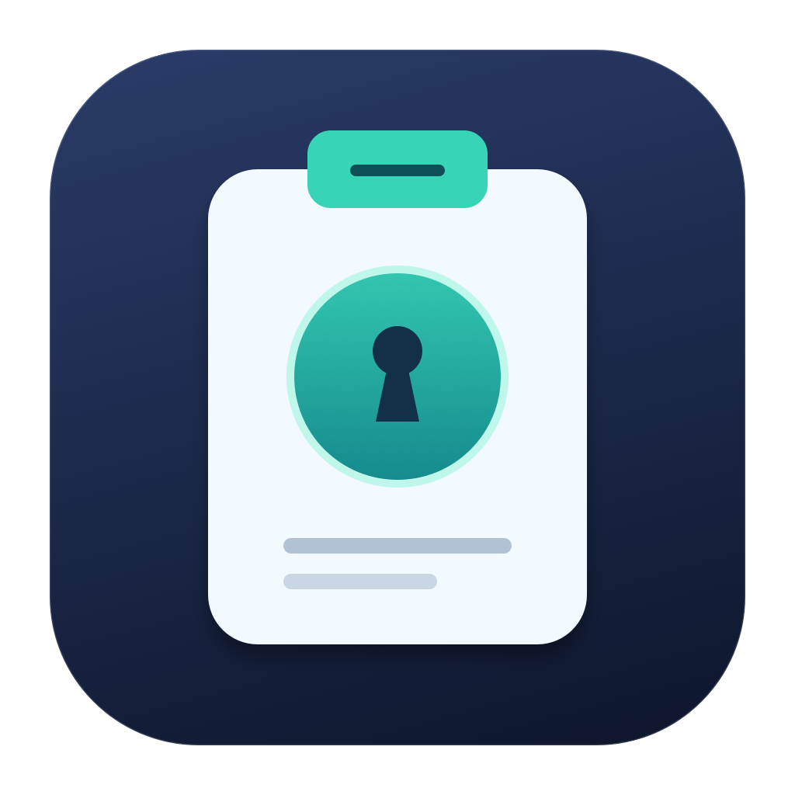
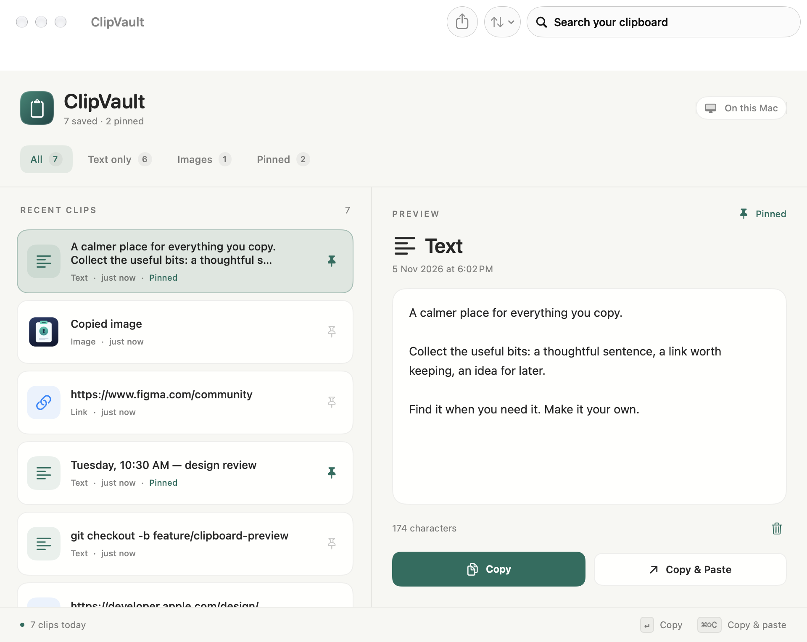
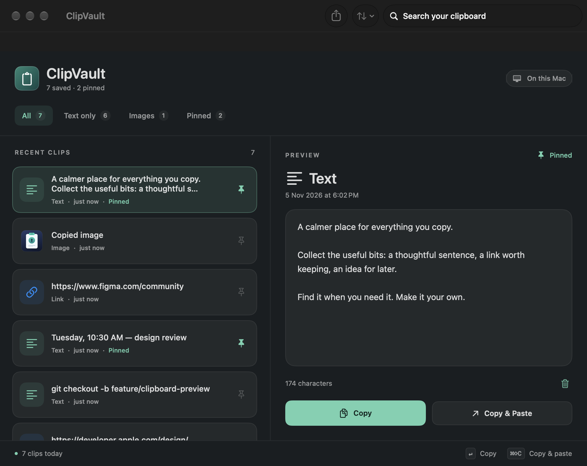
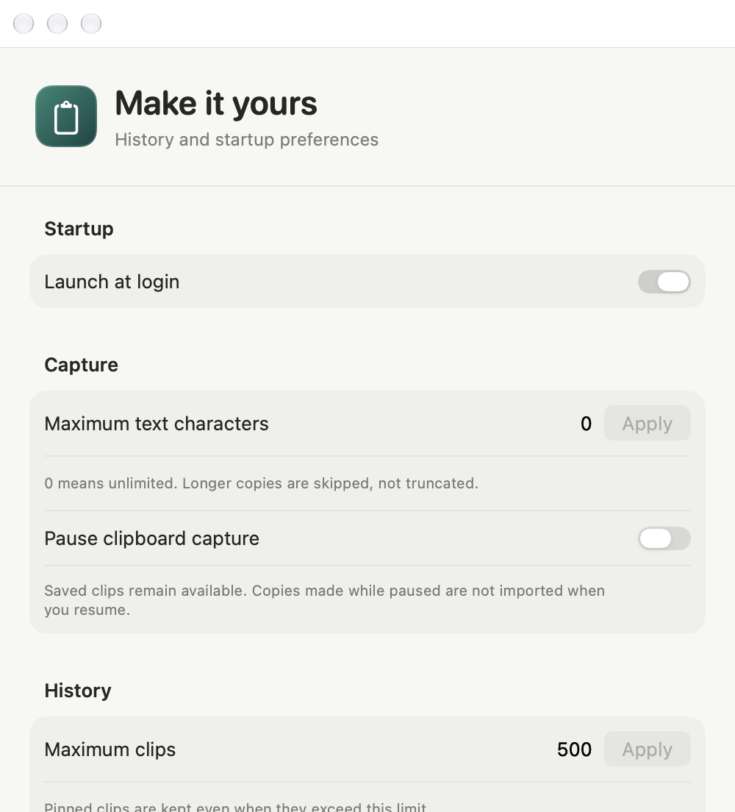

<!-- Purpose: Introduce ClipVault, show its native interface, and guide users and contributors. -->
<div align="center">
  
  <h1>ClipVault</h1>
  <p><strong>A calmer place for everything you copy.</strong></p>
  <p>A native macOS menu bar app for text, links, images, and the things you want to keep.</p>
  <p>
    
    
    <a href="LICENSE"></a>
  </p>
  <p>
    <a href="#the-small-things-add-up">Features</a> ·
    <a href="#run-it-on-your-mac">Get started</a> ·
    <a href="#your-clipboard-stays-on-your-mac">Privacy</a> ·
    <a href="CONTRIBUTING.md">Contribute</a>
  </p>
</div>

<br>

<picture>
  <source media="(prefers-color-scheme: dark)" srcset="Design/Previews/history-dark-window.png">
  <source media="(prefers-color-scheme: light)" srcset="Design/Previews/history-light-window.png">
  
</picture>

<p align="center"><sub>Native SwiftUI. Light and dark appearances. Sample content shown.</sub></p>

> **Development preview:** build from source for now. A signed, notarized download and Homebrew cask are not published yet. The repository is MIT-licensed and currently private while we prepare for public access.

## The small things add up

Copy something. Bring up ClipVault with <kbd>⌘</kbd> <kbd>⇧</kbd> <kbd>V</kbd>. Find it again when you need it.

| | What you can do |
| :--- | :--- |
| **Find it fast** | Search stored text, filter by type or pins, and sort newest, oldest, or pinned first. |
| **Keep the useful bits** | Pin clips so they survive automatic pruning. Preview full text and saved images. |
| **Read text from images** | Run on-device OCR on a saved image, select the result, and copy it as text. |
| **Copy it your way** | Trim whitespace, flatten text to one line, or change case without editing the original. |
| **Stay in control** | Pause capture, set a history limit, skip oversized text, or clear only unpinned clips. |
| **Keep it close** | Reuse the ten newest clips from the menu bar and optionally launch at login. |
| **Take text with you** | Export the current text results as JSON, including timestamps and pin state. |

<details>
<summary><strong>A closer look at the interface</strong></summary>

### Light


### Dark



### Make it yours



These are renders of the actual app views using generated sample data, not personal clipboard history.

</details>

## Run it on your Mac

You need **macOS 14 or later** and **Xcode** to run the app through its project. Repository access is required while the source is private.

```sh
git clone https://github.com/amritkang165/ClipVault.git
cd ClipVault
open ClipVault.xcodeproj
```

Choose the **ClipVault** scheme, select **My Mac**, and press <kbd>⌘</kbd> <kbd>R</kbd>. Swift Package Manager resolves the dependencies automatically. Look for the clipboard icon in your menu bar, then copy some fresh text or an image.

For command-line development and regression checks:

```sh
swift build
python3 Checks/run.py
```

The checks use temporary databases, private pasteboards, and generated images. A command-line build is not a signed app installer. Follow the [release guide](Distribution/ReleaseGuide.md) when preparing a distributable build.

## A few keys to remember

| Shortcut | Action |
| :--- | :--- |
| <kbd>⌘</kbd> <kbd>⇧</kbd> <kbd>V</kbd> | Open history and focus search |
| <kbd>Return</kbd> | Copy the selected clip; keep history open |
| <kbd>⌘</kbd> <kbd>C</kbd> | Copy the selected clip |
| <kbd>⌘</kbd> <kbd>⇧</kbd> <kbd>C</kbd> | Copy and paste into the previous app |
| <kbd>Delete</kbd> | Delete the selected clip |

Row shortcuts apply when you are not editing a text field. **Copy & Paste** requires macOS Accessibility permission; ordinary copying does not use simulated keystrokes.

## Your clipboard stays on your Mac

Clipboard history is stored locally. There is no clipboard upload, cloud sync, or remote OCR service.

```text
~/Library/Application Support/ClipVault/
├── clips.sqlite3       # Text, timestamps, pins, and image paths
└── clip-<UUID>.png      # Saved images
```

Preferences use macOS UserDefaults. Password-copy filtering is enabled by default and uses identifiable clipboard markers and app information.

A few limits are worth understanding:

- **History and exports are not encrypted by ClipVault.** Backups and other software with file access may copy them.
- **Password filtering is best effort.** It cannot identify every sensitive copy.
- **OCR results are temporary.** They are not automatically saved, searched, or included in text exports.
- **Clear all includes pins.** Clear unpinned preserves them. Neither clears the current system clipboard or existing exports.

Read the [privacy notes](Docs/Privacy.md) for the details.

## Build it with us

Pick something that interests you from the [issue tracker](https://github.com/amritkang165/ClipVault/issues). Issues include scope, acceptance criteria, and suggested starting points. Comment before you start so we can avoid duplicate work.

- **Start small:** [show a successful-copy confirmation](https://github.com/amritkang165/ClipVault/issues/6).
- **Improve a daily workflow:** [save recognized text](https://github.com/amritkang165/ClipVault/issues/3) or [customize the global shortcut](https://github.com/amritkang165/ClipVault/issues/4).
- **Help ship it:** [automated checks](https://github.com/amritkang165/ClipVault/issues/8) and [release verification](https://github.com/amritkang165/ClipVault/issues/9).

The [contribution guide](CONTRIBUTING.md) covers setup, testing, and pull requests. Public contributions can begin once repository access is opened; collaborators can work on these issues now.

## Go a little deeper

| For | Guides |
| :--- | :--- |
| Everyday use | [Controls](Docs/Usage.md) · [Search](Docs/Search.md) · [Pins & retention](Docs/Retention.md) |
| Images & shortcuts | [Image text recognition](Docs/Images.md) · [Copy & Paste](Docs/CopyAndPaste.md) · [Launch at login](Docs/LoginItems.md) |
| Getting unstuck | [Troubleshooting](Docs/Troubleshooting.md) · [Reporting a problem](Docs/Support.md) |
| Development | [Architecture](Docs/Architecture.md) · [Local workflow](Docs/Development.md) · [Manual checks](Docs/ManualTesting.md) |
| Distribution | [Release guide](Distribution/ReleaseGuide.md) · [Checklist](Distribution/ReleaseChecklist.md) · [Release notes template](Distribution/ReleaseNotesTemplate.md) |

## Built with

Swift, SwiftUI, AppKit, and Apple Vision, with [SQLite.swift](https://github.com/stephencelis/SQLite.swift) for storage and [HotKey](https://github.com/soffes/HotKey) for the global shortcut.

## License

[MIT](LICENSE) © 2026 Amrit Kang. Use, modify, and redistribute with the copyright and license notice retained. Dependencies keep their [own licenses](ClipVault/ThirdPartyNotices.txt).
